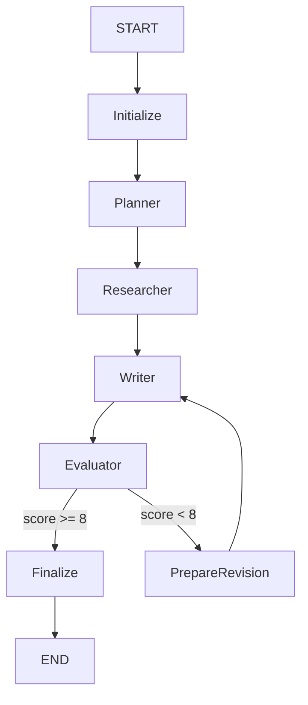
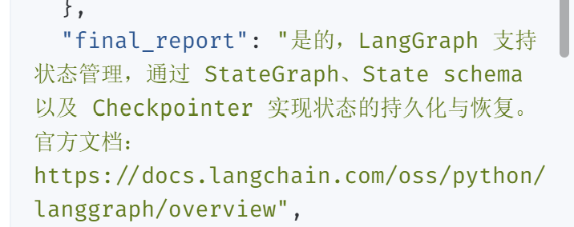

# ResearchPilot

基于 LangGraph、DeepAgents、DeepSeek 和 Tavily 构建的多 Agent 智能研究系统。

系统采用 Planner、Researcher、Writer、Evaluator 四角色协作，并通过显式 StateGraph 实现固定执行顺序、结构化状态传递和低分自动重写。

## 核心功能

- Planner：生成不超过三步的研究计划
- Researcher：执行一次 Tavily 检索，对最多 3 个候选 URL 进行本地域名校验并依次尝试抓取，选取首个可用网页；正文切块后通过 BM25 排序，向 Writer 提供最多 1200 字符的证据片段
- Writer：根据研究证据生成带引用的报告
- Evaluator：输出 1～10 分的结构化评估结果
- 评分低于 8 时自动触发 Writer 重写
- 最多重写一次，避免无限循环和成本失控
- 支持 LangGraph Studio 流程追踪
- 包含单元测试、评测数据集和离线指标计算
- 提供 Dry Run，防止误调用付费 API

## 网页 RAG（轻量版）

Researcher 的流程是：问题 → Tavily 获取候选网页 → 本地域名校验 → 依次尝试抓取 → 正文分块 → BM25 排序 → 限长证据 → Writer 生成。这里的检索是本地稀疏词项检索，不使用 embedding 或向量数据库，也不额外消耗模型 Token；只有选中的片段会进入 Writer 上下文。每段保留页内 chunk 编号和来源 URL，未匹配到词项时显式提示需人工核验。

局限：目前最多检查 3 个候选网页，并使用首个通过域名校验且成功抓取的来源；中文问题与英文网页可能出现词项不匹配；BM25 相关不等于网页事实正确，更不等于报告中的每句话已被证据支持。引用仍应人工核验。原有 5 条评测结果来自此次检索升级之前，不能当成新版 RAG 的效果指标。

离线检索测试（不会调用模型、Tavily 或网页）：

```powershell
.\.venv\Scripts\python.exe -B -m unittest discover -s tests -p "test_rag.py" -v
```

### 离线检索验证

| 数据集／阶段 | 案例数 | Hit@1 | Hit@2 |
|---|---:|---:|---:|
| 验证集：双语术语扩展前 | 3 | 1/3 | 2/3 |
| 验证集：双语术语扩展后 | 3 | 2/3 | 3/3 |
| 新增测试集（未用于本轮调参） | 3 | 3/3 | 3/3 |

验证集涉及 Checkpointer、流式状态和 Interrupt，并参与了双语术语规则调整。新增测试集涉及 Functional API、原始状态数据和故障处理，未用于本轮调参。

两组案例均使用人工截取的短网页片段，样本量很小。Hit@K 只衡量目标片段是否进入前 K 名，不代表完整网页检索的成功率，也不判断报告结论是否得到证据支持。

离线复现（不调用模型或 Tavily）：

```powershell
.\.venv\Scripts\python.exe -B run_retrieval_evaluation.py --cases evals\validation_evidence_cases.json
.\.venv\Scripts\python.exe -B run_retrieval_evaluation.py --cases evals\test_evidence_cases.json
```

## 工作流架构



共享状态包括：

```text
query
plan
research
draft
evaluation
revision_count
final_report
```

## 自动质量闭环

Evaluator 返回以下结构化数据：

```json
{
  "score": 8,
  "problems": [],
  "suggestions": [],
  "improvement_actions": []
}
```

路由规则：

```text
score >= 8 → 输出最终报告
score < 8 且 revision_count < 1 → Writer 重写
score < 8 且达到重写上限 → 结束
```

该设计避免完全依靠提示词控制 Agent 顺序，并防止无限循环。

## 项目结构

```text
deep_research/
├── agent.py
├── explicit_agent.py
├── run_evaluation.py
├── langgraph.json
├── evals/
│   └── cases.json
├── research_agent/
│   ├── evaluation.py
│   ├── eval_runner.py
│   ├── models.py
│   ├── nodes.py
│   ├── prompts.py
│   ├── rag.py
│   ├── routing.py
│   ├── schemas.py
│   ├── state.py
│   ├── subagents.py
│   ├── tools.py
│   └── workflow.py
└── tests/
    ├── test_eval_cases.py
    ├── test_eval_runner.py
    ├── test_evaluation.py
    ├── test_nodes.py
    ├── test_rag.py
    ├── test_routing.py
    └── test_workflow.py
```

## 环境配置

在 `.env` 中配置：

```env
DEEPSEEK_API_KEY=your_deepseek_api_key
DEEPSEEK_BASE_URL=https://api.deepseek.com
TAVILY_API_KEY=your_tavily_api_key

LANGSMITH_TRACING=true
LANGSMITH_ENDPOINT=https://api.smith.langchain.com
LANGSMITH_API_KEY=your_langsmith_api_key
LANGSMITH_PROJECT=ResearchPilot
```

不要提交包含真实密钥的 `.env`。

安装依赖：

```powershell
uv sync --python 3.12.14
```

## 启动方式

```powershell
.\.venv\Scripts\langgraph.exe dev
```

在 LangGraph Studio 中选择：

```text
research_explicit
```

输入时只填写 `Query`，其他状态字段留空。例如：

```text
LangGraph支持状态管理吗？一句话回答，附1个官方URL。
```

### Windows 一键启动

运行测试并启动 LangGraph Studio：

```powershell
powershell -ExecutionPolicy Bypass -File .\start.ps1
```

已经验证测试后，可以跳过测试启动：

```powershell
powershell -ExecutionPolicy Bypass -File .\start.ps1 -SkipTests
```

启动服务器本身不会调用模型或搜索 API，只有在 Studio 提交问题后才会产生费用。

## 两种工作流实现


`langgraph.json` 同时保留两种实现：

- `research`：基于 DeepAgents 官方示例改造的多 Agent 流程
- `research_explicit`：使用显式 StateGraph、条件边和状态流转的新流程

推荐使用 `research_explicit`。

## 自动化测试

运行全部本地测试：

```powershell
.\.venv\Scripts\python.exe -m unittest discover -s tests -p "test_*.py" -v
```

这些测试使用假模型和假搜索工具，不调用 DeepSeek 或 Tavily。

当前版本已通过 44 项离线自动化测试，包括非白名单域名拦截和候选网页抓取失败后的回退测试。

当前测试覆盖：

- 评分路由
- 最大重写次数
- 状态初始化
- Planner 节点
- Researcher 节点
- Writer 首次生成和自动重写
- Evaluator 结构化输出
- StateGraph 完整流程
- 评测数据集
- 离线指标计算
- 评测运行器

## 评测

安全预览，不调用 API：

```powershell
.\.venv\Scripts\python.exe run_evaluation.py
```

真实运行一个案例，会调用 API：

```powershell
.\.venv\Scripts\python.exe run_evaluation.py --execute --limit 1
```

评测指标包括：

- 流程成功率
- 官方域名引用率
- 关键词命中率
- 平均评分
- 平均重写次数
- 平均运行时间
- 平均输入、输出和总 Token
- 总估算成本和单次平均估算成本

## 成本控制

一次正常流程包含：

- Planner：1 次模型调用
- Researcher：1 次 Tavily 搜索，最多 3 次网页 HTTP 抓取
- Writer：1 次模型调用
- Evaluator：1 次模型调用

如果评分低于 8，最多增加一次 Writer 和 Evaluator 调用。

其他成本控制措施：

- Planner 最多输出三步
- Researcher 每次只执行一次搜索
- 测试问题限制为一句话回答
- 重写次数限制为一次
- 评测运行器默认只预览，不执行 API
- 单元测试全部使用假模型和假工具

## 已验证结果

以下 5 条结果来自新增网页正文抓取功能之前，是历史基线，不代表当前版本的成功率、耗时、Token 或成本。
已完成 5 个低成本案例的真实端到端评测：

| 指标 | 结果 |
|---|---:|
| 流程成功率 | 100% |
| 官方引用有效率 | 100% |
| 关键词命中率 | 100% |
| Evaluator 平均评分 | 8.8/10 |
| 平均运行时间 | 4.696 秒 |
| 平均 Token | 3024.6 |
| 总 Token | 15123 |
| 单次平均估算成本 | $0.00054999 |
| 5 次总估算成本 | $0.00274995 |

评测过程中 Planner、Researcher、Writer、Evaluator 均成功执行，最终报告均包含受信任的 LangGraph 官方文档来源。

引用有效性采用以下官方域名白名单：

- `docs.langchain.com`
- `reference.langchain.com`
- `langchain-ai.github.io`

成本根据评测时配置的低峰期 Token 单价估算，实际费用以模型服务商账单为准。当前结果来自 5 个小规模案例，主要用于验证完整流程和建立初步性能基线。

## 运行截图

下面展示了 ResearchPilot 生成的最终报告。报告包含简短结论和官方文档来源。



## 当前限制

- 目前最多检查 3 个候选网页，并使用首个可用来源；有限长度的正文片段可能无法覆盖问题中的全部子结论，且抓取成功不等于结论已获人工核验。
- 引用有效性目前只检查域名是否出现在报告中
- 评测数据集目前包含 10 个小规模案例
- Token 与估算成本由评测运行器自动统计，实际账单仍以模型服务商为准
- 原始 DeepAgents 示例仍保留用于实现对比
